<a href="https://astrosynx.org/tech">
  
</a>

<p>
  <a href="https://astrosynx.org/"></a>
  <a href="https://astrosynx.org/tech"></a>
  <a href="https://astrosynx.org/readiness/"></a>
  <a href="https://astrosynx.org/decentralization-monad"></a>
</p>

Four small, read-only bash checks for a running Monad node. They look at the layers underneath consensus: systemd services, keystores, sync progress and the TrieDB drive. The goal is to catch a broken disk, a world-readable key or a silently stalled node before it shows up as missed blocks.

They are written by [Astrosynx](https://github.com/astrosynx), a validator selected for the Monad Foundation Delegation Program, and run on our own mainnet and testnet nodes.

**Contents:** [Tools](#tools) · [Run](#run) · [Configuration](#configuration) · [Automate](#automate) · [Scope](#scope)

<br>

## Tools

| Script | What it checks | Fails when |
|---|---|---|
| [`node-health-check.sh`](./tools/node-health-check.sh) | `monad-bft` and `monad-execution` are active, and `monad-rpc` too if present. P2P port `8000` is listening. Optionally checks the RPC, which reports the chain ID: `143` mainnet, `10143` testnet. Also clock offset and free disk space. | A core service is down, the port is closed, the RPC gives no answer, the clock is off by more than 5 s, or free disk is under 10% |
| [`keystore-integrity-check.sh`](./tools/keystore-integrity-check.sh) | `id-secp` and `id-bls` exist, are not empty, have no group or other permission bits, and are owned by `monad`. | A keystore is missing or empty, or readable by anyone except its owner |
| [`sync-state-inspector.sh`](./tools/sync-state-inspector.sh) | Block height, `eth_syncing`, peer count, and whether the height has moved since the last run. | The RPC is down, or the height has not changed for 300 s or more |
| [`triedb-sanity-check.sh`](./tools/triedb-sanity-check.sh) | `/dev/triedb` resolves to a block device, is not mounted, and uses **512-byte LBA**. It also takes a 1 MiB direct-I/O read sample. | The device is missing or mounted, the LBA is not 512 bytes, or the sample is slower than 50 ms |

Every script exits **`0`** when all checks pass and **`1`** on the first failure. Lines marked `!` are warnings that do not change the exit code.

> [!NOTE]
> **Nothing here writes to the node.** The scripts never sign or export keys, change config, or restart services. The TrieDB check only reads 1 MiB from the device with `dd`.

<br>

## Run

Read any remote script before you run it. Each one is under 150 lines.

```bash
git clone https://github.com/astrosynx/Monad-Tools.git && cd Monad-Tools

bash tools/node-health-check.sh
RPC_ENDPOINT=http://127.0.0.1:8080 bash tools/node-health-check.sh
sudo -u monad bash tools/keystore-integrity-check.sh
RPC_ENDPOINT=http://127.0.0.1:8080 bash tools/sync-state-inspector.sh
bash tools/triedb-sanity-check.sh
```

<details>
<summary><b>One-liners without cloning</b></summary>
<br>

```bash
bash <(curl -fsSL https://raw.githubusercontent.com/astrosynx/Monad-Tools/main/tools/node-health-check.sh)
sudo -u monad bash <(curl -fsSL https://raw.githubusercontent.com/astrosynx/Monad-Tools/main/tools/keystore-integrity-check.sh)
RPC_ENDPOINT=http://127.0.0.1:8080 bash <(curl -fsSL https://raw.githubusercontent.com/astrosynx/Monad-Tools/main/tools/sync-state-inspector.sh)
bash <(curl -fsSL https://raw.githubusercontent.com/astrosynx/Monad-Tools/main/tools/triedb-sanity-check.sh)
```
</details>

**Requirements:** bash, systemd, `curl`, `iproute2` (`ss`), `util-linux` (`lsblk`, `blockdev`, `findmnt`). The sync inspector also needs `jq`. `chronyc` is optional and enables the clock check. The keystore check must run as `monad` or root to read `/home/monad`.

<br>

## Configuration

Defaults follow the [official node installation guide](https://docs.monad.xyz/node-ops/full-node-installation). Override any of them with environment variables.

| Variable | Default | Used by |
|---|---|---|
| `RPC_ENDPOINT` | unset, or `http://localhost:8080` in the sync inspector | node-health, sync-state |
| `P2P_PORT` | `8000` | node-health |
| `DISK_PATH` | `/` | node-health |
| `KEYSTORE_BASE` | `/home/monad/monad-bft/config` | keystore |
| `SECP_KEYSTORE` / `BLS_KEYSTORE` | `$KEYSTORE_BASE/id-secp` / `id-bls` | keystore |
| `KEYSTORE_OWNER` | `monad` | keystore |
| `STAGNATION_THRESHOLD` | `300` seconds | sync-state |
| `STATE_FILE` | `/tmp/monad_last_block` | sync-state |
| `TRIEDB_DEVICE` | `/dev/triedb` | triedb |
| `EXPECTED_LBA` | `512` | triedb |
| `MAX_READ_LATENCY_MS` | `50` | triedb |

> [!WARNING]
> If the TrieDB check reports the wrong LBA size, **do not reformat a live node.** Changing the LBA format erases the drive. Fix it during a planned rebuild, following the TrieDB section of the official guide.

<br>

## Automate

The sync inspector keeps the last height it saw and the time that height **first** appeared. A stall is therefore detected whether the script runs every minute or every hour. A cron entry that logs only failures:

```bash
# /etc/cron.d/monad-checks
*/5 * * * * monad RPC_ENDPOINT=http://127.0.0.1:8080 bash /opt/Monad-Tools/tools/sync-state-inspector.sh >/dev/null || logger -t monad-check "sync stalled"
0 * * * *   monad bash /opt/Monad-Tools/tools/node-health-check.sh >/dev/null || logger -t monad-check "health check failed"
```

The exit codes also work as a Prometheus textfile metric or as a gate in CI before an upgrade.

<br>

## Scope

These scripts check the **host**, not the protocol. For consensus and application-level diagnostics, use the official tools:

| Official tool | Use it for |
|---|---|
| `monad-status` | Overall node status |
| `monlog` | BFT log analysis and health suggestions |
| `monad-ledger-tail` | Streaming the consensus ledger |
| `monad-mpt --storage /dev/triedb` | Internal TrieDB metadata |

Before a network upgrade, also run the **[Monad Validator Readiness Kit](https://astrosynx.org/readiness/)**. It checks your RPC, chain ID, sync status, block lag against a reference RPC, and upcoming hard-fork MIPs.

<br>

---

<sub>MIT licensed · <a href="./CHANGELOG.md">Changelog</a> · Maintained by <a href="https://github.com/astrosynx">Astrosynx</a> · <a href="https://astrosynx.org/">astrosynx.org</a> · <a href="https://astrosynx.org/tech">Operator hub</a> · <a href="https://docs.monad.xyz/node-ops">Monad node ops docs</a></sub>

